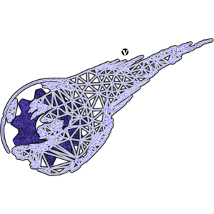

#  V-Gears

**Final Fantasy VII, running on a new, free engine.**

V-Gears is a reimplementation of the Final Fantasy VII engine. It takes the data from your own PC copy of the game and runs it natively on a modern system, with no emulator in between. The fields, the battles, the menus and the world map are being rebuilt one piece at a time, with open code that anyone can read, fix and extend.

  
  

> V-Gears contains **no copyrighted data** from the original game. Its installer extracts what it needs, on your machine, from your own disks. All the screenshots on this page are real V-Gears captures, but the models, textures, backgrounds and other art in them belong to the original game and are not distributed here.

## How far along is it?

It's a work in progress: there is plenty to see and play, but expect bugs and missing pieces.

| Part | State | In short |
|--|--|--|
| [Field maps](#field-maps) | 🟢 Mostly playable | Almost all maps work, with dialogs, music and videos |
| [Battles](#battles) | 🟢 Mostly playable | Most commands and spells work; many are still missing their effects |
| [Menus](#menus) | 🟢 Mostly complete | Items, materia, equipment, party, shops, saving and more |
| [World map](#world-map) | 🟡 Playable, with bugs | Walk, drive, sail and fly around |
| Minigames | 🔴 Missing | They are skipped, and the story goes on |

This page describes the current development code, which can be ahead of the latest release. The [changelog](doc/CHANGELOG.md "Changelog") tells what each release brought.

## Field maps

Walk around Midgar and beyond. Most models, animations and script opcodes are converted and running, along with background music, animated backgrounds, random encounters and the original videos. Some maps still have bugs or quirks, and a few can crash the game.

|**Cloud model**|**Dialogs**|**Animations**|
|--|--|--|
||||
|**Transparencies**|**Timers**|**Choices**|
||||

## Battles

Battles are pretty much playable, with the original enemies, formations, models, animations and AI scripts.

- **Rules:** damage, hit and turn order formulas, checked against the original executable.
- **Commands:** the battle menu follows the equipped materia, with attacks and magic, Steal, Sense, Throw, Coin, Morph, Manipulate, Mime, Enemy Skill, the W commands and more.
- **Materia:** linked support materia such as All, Quadra Magic, Counter or Final Attack.
- **Limit breaks:** the limit bar, learning new techniques and multi-hit attacks.
- **Spectacle:** the original battle cameras, caster auras, effects for the Fire, Ice, Bolt and Cure spells and some status magic, and the Shiva, Ifrit and Ramuh summons.

Still on the way: effects for the other spells and summons, Cait Sith's and Vincent's special limits, and plenty of fine tuning.

## Menus

Most menus are implemented and behave like the originals: items, magic, materia, equipment, status, order, limits, config, party swapping, shops and saving. A few details are still missing. For example, characters keep their default names, as the name menu is switched off for now.

|**Begin**|**Main**|**Materia**|
|--|--|--|
||||
|**Items**|**Save**|**Equip**|
||||

## World map

The world map is playable, and it runs on the original world scripts, so it follows your progress in the story. Explore the overworld, the depths of the ocean and the snowfield: walk, enter most cities, get into fights, and travel by chocobo, buggy, Tiny Bronco, submarine or airship, with animated water, fog, snow and changing music. There are still a number of bugs and some unfinished scenes.

|**World map**|**The Highwind**|**On the move**|
|--|--|--|
||||

## The installer

The installer turns your copy of the game into data that V-Gears can use. Point it to the ISO image of the PC install disk, choose a folder, and let it work. It converts the sounds, the music and the videos (with the help of FFmpeg and TiMidity; the videos come from the three game disks), and then it can verify the result and launch the game.

|**Installer**|**Advanced options**|
|--|--|
|||

## Under the hood

V-Gears is written in C++14, with [Ogre](https://www.ogre3d.org/ "Ogre") for the graphics and LuaJIT for the scripts. The original field and world scripts are decompiled into Lua during the installation, and the battles and menus are written in Lua too, so a lot of the game can be read and changed without recompiling.

When the original behaviour isn't documented, it is worked out from the game itself: damage formulas, camera scripts, summon effects and more come from studying the original executable and data files.

Debug tools help to see what is going on:

|**Field maps**|**Walkmesh**|**Console**|
|--|--|--|
||||

## Try it

You need your own copy of the PC version of Final Fantasy VII, as disk images. The guides cover Linux.

1. **Get V-Gears:** download a package from the [releases](https://github.com/InigoValentin/V-Gears/releases "Releases") (they only work on systems with the same library versions as the one they were built on), or [build it yourself](doc/BUILD.md "Building guide").
2. **Add the game data** with `v-gears-installer`, following the [data installation guide](doc/INSTALL_DATA.md "Data installation guide").
3. **Play:** start `v-gears`. The [run guide](doc/RUN.md "Run guide") lists the controls.

## A bit of history

V-Gears continues [Q-Gears](https://github.com/q-gears/q-gears "Q-Gears on Github"), an enormous project started in 2006 by some great people with the same purpose, which unfortunately stalled. Read the [whole story](doc/HISTORY.md "V-Gears history").

## Join in

If you want to see this finished, help is welcome. Clone the repo, read the [C++](doc/STYLE.md "V-Gears C++ Style Guide") and [Lua](doc/STYLE-LUA.md "V-Gears Lua Style Guide") style guides, pick something from the [to-do list](doc/TODO.md "To-do list") (or whatever breaks first when you play), and have a go at it!

V-Gears is free software, released under the [GNU General Public License v3](COPYING.txt "License").
