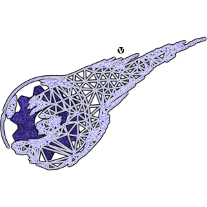

#  V-Gears Building Guide

## Install dependencies
If you are runind Debian (or derivates), you can install the required dependencies by running as root

```bash
apt install g++ cmake libqt5widgets5 qtbase5-dev zlib1g-dev libarchive-dev libogre-1.12-dev libois-dev libvorbis-dev libboost-dev libboost-program-options-dev libboost-test-dev libboost-filesystem-dev libboost-thread-dev libopenal-dev libtinyxml-dev libluajit-5.1-dev
```

## Deterministic fallbacks

The CMake scripts include an option `USE_DETERMINISTIC_FALLBACKS` (default `ON`).
- When `ON`, CMake will attempt pragmatic fallbacks to find libraries when
	`find_package`/pkg-config do not succeed (SONAME `find_library` passes,
	appending common `/usr/lib` paths, or injecting generic `-lboost_*` flags).
- When `OFF`, CMake will not perform these fallbacks; instead require proper
	dev packages or explicit hints.

**Leave it `ON` for now.** On Linux, the regular library detection in `src/CMakeLists.txt` is skipped because of a
known bug in the script, so with the fallbacks `OFF` the build fails to link Boost and OgreBites.

If you see warnings about missing Boost or OgreBites, prefer installing the
appropriate `-dev` packages listed above, or point CMake at your OGRE/Boost
installation with `-DOGRE_ROOT=...` and `-DBoost_DIR=...`/`-DBoost_LIBRARY_DIRS`.


## Build using CMake

From the project directory, run these commands:

```bash
mkdir build;
cd build;
cmake ../;
make;
```

If you want to speed it up a bit (it can take several minutes, depending on your system), you can add the parameter `-j` to make to use multiple threads. For instance, `make -j3` will use three cores for the compilation.

Once the build process finishes, you u sholh have the following files (from the project directory):

- `build/bin/v-gears`, the engine executable.
- `build/bin/v-gears-installer`, the data installer.

The engine can be launched from anywhere: it finds its data directory (`~/.v-gears/` by default) and fills it from the `data/` folder of the repository the first time. See the [run guide](RUN.md "Run V-Gears") for details.

## Run the tests (optional)

The tests are not built by default. To build and run the tests of the installer logic (the option rules, the installation layout, the verifier, the log and the tool finder), which don't need the rest of the engine:

```bash
mkdir build-tests;
cd build-tests;
cmake ../ -DBUILD_TESTS=ON;
make v-gears-installer-tests;
./bin/v-gears-installer-tests
```

## Make packages (optional)

V-Gears can be packaged for Linux as a `.deb` package and as a `.tar.gz` archive. None of them includes data from the original game: the player still needs the data installer and their own copy of the game.

### Build the packages

Use a separate Release build, so it doesn't interfere with your development build. From the project directory:

```bash
mkdir build-release;
cd build-release;
cmake ../ -DCMAKE_BUILD_TYPE=Release;
make -j4 v-gears v-gears-installer;
cpack;
```

The first build takes a while. Adjust `-j` to the number of cores and the memory of your system: each compiler process can use a lot of memory, so don't go as high as the number of cores if memory is short.

When `cpack` finishes, `build-release/` contains:

- `v-gears_<version>_amd64.deb`, the Debian package.
- `v-gears-<version>-Linux-x86_64.tar.gz`, the archive.
- A `.sha256` checksum file for each of them. Publish them along with the packages.

The version is the one in the `project()` line of the main `CMakeLists.txt`. To make only one of the packages, use `cpack -G DEB` or `cpack -G TGZ`.

### What's in the packages

Both have the same files:

- `bin/v-gears` and `bin/v-gears-installer`, the engine and the data installer.
- `share/v-gears/`, the V-Gears data files (configuration, scripts, screens, fonts...). The engine copies them to the user's data directory (`~/.v-gears/`) the first time it runs, and the data installer adds the game data there.
- `share/doc/v-gears/`, the documentation and the license.
- The desktop files and the icons, so both programs show in the applications menu.

The `.deb` installs them under `/usr`. Install it with `apt`, so it installs the dependencies too:

```bash
sudo apt install ./v-gears_0.3.0_amd64.deb
```

The `.tar.gz` has the same layout in a single folder. It can be extracted anywhere and run from there (`bin/v-gears`, `bin/v-gears-installer`), without root.

The Ogre plugins (`RenderSystem_GL`, `Codec_STBI`) are not in the packages: the engine loads the ones of the system's Ogre.

### Which systems can use them

The packages don't include any library: they use the ones installed in the system. The dependencies of the `.deb` are taken from the libraries the programs were built with, so it can only be installed in systems that have the same versions (the same Ogre and Boost versions, especially). In practice, the packages work in the same distribution and version where they were built.

To make packages for a given distribution, build them in that distribution, for example in a container or a virtual machine. The `.tar.gz` has the same limits, but it gives no warning: if a library is missing, the programs don't start.

### Build options

These can be set when running `cmake` (`-D<option>=<value>`):

|Option|Default|Description|
|--|--|--|
|`CMAKE_BUILD_TYPE`|`Release`|Use `Release` for packages. A `Debug` build makes much larger programs, and its archive name ends in `-debug`.|
|`VGEARS_OGRE_PLUGIN_DIR`|Found at build time|Directory of the system's Ogre plugins. The engine looks for the plugins there after its data directory and its own directory. Set it if the plugins of the target system are in another place.|
|`VGEARS_PACKAGE_MAINTAINER`|The project maintainer|Name and email of the maintainer in the `.deb`.|

### Install without a package

To install V-Gears directly in the system, with the same files and layout as the packages:

```bash
sudo cmake --install . --prefix /usr/local
```

## Optional programs

To convert the sound effects and the music, the installer uses FFmpeg and TiMidity. They are not needed to build V-Gears, only to install the data. See the [data installation guide](INSTALL_DATA.md "Install Data").

## Next steps

- [Install V-Gears](INSTALL.md "Install V-Gears")
- [Install data](INSTALL_DATA.md "Install Data")
- [Run V-Gears](RUN.md "Run V-Gears")
