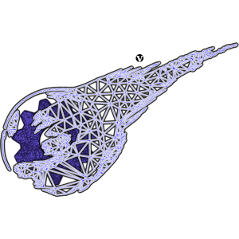

#  V-Gears Building Guide

## Install dependencies
If you are running Debian (or derivates), you can install the required dependencies by running as root

```bash
apt install g++ cmake libqt5widgets5 qtbase5-dev zlib1g-dev libarchive-dev libogre-1.12-dev libois-dev libvorbis-dev libboost-dev libboost-program-options-dev libboost-test-dev libboost-filesystem-dev libboost-thread-dev libopenal-dev libtinyxml-dev libluajit-5.1-dev ffmpeg timidity
```

## Build using CMake

From the project directory, run these commands:

```bash
mkdir build;
cd build;
cmake ../;
make;
```

If you want to speed it up a bit (it can take several minutes, depending on your system), you can add the parameter `-j` to make to use multiple threads. For instance, `make -j3` will use three cores for the compilation. The build uses a lot of memory, so on machines with little RAM, use a low number (`-j2`).

Once the build process finishes, you should have the following files (from the project directory):

- `build/bin/v-gears`, the engine executable.
- `build/bin/v-gears-installer`, the data installer.

The engine must be launched from the installation directory (the installer starts it from there for you), so before trying to run it, keep reading.

## Run the tests (optional)

The tests are not built by default. To build and run the tests of the installer logic (the option rules, the installation layout, the verifier, the log and the tool finder, the movie camera data), which don't need the rest of the engine:

```bash
mkdir build-tests;
cd build-tests;
cmake ../ -DBUILD_TESTS=ON;
make v-gears-installer-tests;
./bin/v-gears-installer-tests
```

The engine tests (for example the movie state and camera frames) are in the `v-gears-tests` target, built the same way.

<!-- TODO(review): check that `make v-gears-tests` builds on its own and whether more build dependencies (video, audio) are required now. -->

## Advanced build options

### Deterministic fallbacks

You don't need this for a normal build. It only matters if CMake can't find a library that is installed, or if you are packaging V-Gears.


The CMake scripts include an option `USE_DETERMINISTIC_FALLBACKS` (default `ON`).
- When `ON`, CMake will attempt pragmatic fallbacks to find libraries when
	`find_package`/pkg-config do not succeed (SONAME `find_library` passes,
	appending common `/usr/lib` paths, or injecting generic `-lboost_*` flags).
- When `OFF`, CMake will not perform these fallbacks; instead require proper
	dev packages or explicit hints (recommended for CI and packaging).

Disable fallbacks example:

```bash
cmake .. -DUSE_DETERMINISTIC_FALLBACKS=OFF -DCMAKE_BUILD_TYPE=Release
```

If you see warnings about missing Boost or OgreBites, prefer installing the
appropriate `-dev` packages listed above, or point CMake at your OGRE/Boost
installation with `-DOGRE_ROOT=...` and `-DBoost_DIR=...`/`-DBoost_LIBRARY_DIRS`.

## Optional programs

To convert the sound effects, the music and the videos, the installer uses FFmpeg and TiMidity. They are not needed to build V-Gears, only to install the data. See the [data installation guide](INSTALL_DATA.md "Install Data").

## Next steps

- [Install V-Gears](INSTALL.md "Install V-Gears")
- [Install data](INSTALL_DATA.md "Install Data")
- [Run V-Gears](RUN.md "Run V-Gears")
