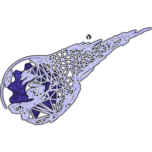

#  V-Gears Installation Guide

## Manual installation

The data installer can do this for you: enable "Copy V-Gears data files" in its advanced options and it copies the `data/` folder of the repository to the installation directory. To do it by hand:

1. Create a folder for V-Gears data, outside the project. In Linux-based systems, it's recommended to use `~/.v-gears/`.
2. Copy all the contents of the `data/` folder of the repository to the newly created directory. It should end up like this:
```
~/.v-gears/
  ├── data
  ├── field_models_and_animation_metadata.xml
  ├── plugins.cfg
  ├── plugins_d.cfg
  ├── RenderSystem_GL.so.1.12.10
  ├── resources.cfg
  └── resources_d.cfg
```
3. Whenever you want to launch V-Gears or the V-Gears data installer, it must be done from this directory.

## Next steps

- [Install data](INSTALL_DATA.md "Install Data")
- [Run V-Gears](RUN.md "Run V-Gears")