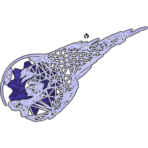

#  V-Gears Data Installation Guide

## What you need

To install the Final Fantasy VII game data you need your own copy of the PC version of the game. The installer reads the **ISO image of the install disk** directly, so there is nothing to extract by hand. It extracts what it needs to `<installation directory>/original_data/` and converts it from there.

If you also want the videos, you need the ISO images of the PC game disks 1, 2 and 3 (see [Extract the videos](#extract-the-videos)). The disks of the PlayStation versions are not supported.

## FFmpeg and TiMidity

The installer converts the sound effects, the music and the videos with two external programs (the videos only need FFmpeg):

- [FFmpeg](https://ffmpeg.org/download.html "FFmpeg") converts the sound effects, encodes the music and converts the videos.
- [TiMidity](https://timidity.sourceforge.net/#download "TiMidity") plays the original MIDI music so FFmpeg can encode it. Only the music needs it.

You don't have to configure anything if they are installed. The installer looks for them, in this order:

1. The program you chose with **Locate…**. The choice is remembered.
2. A `tools` folder inside the installation directory, or next to the installer. On Windows, the easiest way is to copy `ffmpeg.exe` there.
3. The system `PATH`. In most GNU/Linux distributions both are available as packages (for example, `sudo apt install ffmpeg timidity`).

The window shows what the installer found (`Audio tools: FFmpeg ✓ … · TiMidity ✓ …`). Every program is run once to check that it works, and FFmpeg must be able to write ogg files (it needs the Vorbis encoder). On Windows, TiMidity also needs its `timidity.cfg` and the instrument files next to `timidity.exe`.

If a program that the installation needs is missing, the installer tells you before it starts. The message says what you would lose, and you can:

- **Locate…** the program in your system.
- **Get it…**: open its download page.
- **Check again**, for when you have just installed it.
- **Continue without** it. The rest is installed normally, and the sound effects, the music, the videos, or any of them, are left out. The extracted `.wav` and `.mid` files stay in `~/.v-gears/data/audio/`, and the indexes only list the files that exist.
- **Cancel** the installation.

To add the missing audio later, install the programs and run the installer again with only the sound effects and the music selected (the *Media only* option, or *Custom*).

## Launch the Installer

If you have followed the [build](BUILD.md "Building guide") and [installaton](INSTALL.md "Installation guide") guides, you'll have the game data copied to `~/.v-gears/` (or you can let the installer copy it, see below), and the binaries compiled somewhere (we'll assume they are in `~/V-Gears/build/bin`, change the directories according to your system). Just run the installer:

```Bash
~/V-Gears/build/bin/v-gears-installer
```

It can be started from any directory. When the installation starts, it works from the installation directory.

## Run the Installer

1. In **Import data source**, select the ISO image of the install disk. The installer tells you if the image is valid.
2. In **VGears installation directory**, select where to install, for example `~/.v-gears/`. It will be created if it doesn't exist. It holds the configuration and the converted data, and it is where the game runs.
3. (Optional) Select **Show advanced options** to choose what to install (see below). The defaults install everything. If the directory doesn't have the V-Gears files yet (configuration, scripts, screens, fonts...), leave **Copy V-Gears data files** checked, and the installer copies them there from the `data/` folder of the repository.
4. Click **Install data**.

Before extracting anything, the installer checks that everything is in place: that the ISO is valid, that the directory is writable and has enough free space (about 3 GB plus the size of the ISO), and that the FFmpeg and TiMidity programs it needs can be used (see below). If something is wrong it tells you and doesn't start.

The log shows the progress. Problems are shown in color (red for errors, orange for warnings), and the full log is written to `installer.log` in the installation directory. Don't be discouraged by some warnings about skipped fields or models, they are known limitations of the converter. The installation is finished when the progress bar reaches 100% and the window can be closed again.

An installation can only be done once per installer window. To install again, close the installer and open it again. The estimate under the options shows about how much disk space it will use.

When it finishes:

- **Verify install** checks that the installation directory has everything the game needs, and lists what is missing, grouped by part. If you skipped a part on purpose, its files are expected to be missing.
- **Launch game** starts V-Gears from the installation directory.

## Extract the videos

The videos are not on the install disk, but on the PC game disks 1, 2 and 3. To get them, run the installer once for each disk: select the disk's ISO as the data source and the same installation directory, and click 'Install data'. The installer detects a game disk, extracts only its videos to `<installation directory>/data/video/` and doesn't touch anything else. Several disks have the same videos, so those already installed are skipped. Unlike the full installation, it can be repeated with the same installer window.

The engine can't decode the original AVI files (Duck TrueMotion 2 codec), so the installer uses FFmpeg to convert each video to a folder of JPEG frames, an `.ogg` sound track (if the video has sound) and a `movie.xml` with the frame count and frame rate. Movies that carry camera data for the field background also get a `camera.cam` file. They are played by the engine's movie player, which draws the frames and plays the sound. FFmpeg is therefore needed to install the videos.

<!-- TODO(review): confirm the exact output layout under data/video/ (folder per movie, file names) after a fresh install, and which movies play in game. -->

## Battle data

The battle installation extracts the battle scenes, enemy and formation data, the attacks, the field and world map encounter tables, and the battle models and animations. It also extracts the visual assets of the spell effects (`magic.lgp`): the meshes and textures of the effects and the sprite lists, which the battle scripts use to recreate the original spell effects. If you installed before these were added, run the installer again with the battle options selected (*Battle* preset or *Custom*) to get them.

<!-- TODO(review): list of spells with effects (currently the Fire, Ice, Bolt and Cure families) and the reinstall requirement should be re-checked against the current state of battle_fx.lua. -->

## Advanced options

The installer has a list of advanced options, under **Show advanced options**. They have tooltips with short explanations of what they do. For a fresh installation there is usually no need to change them: the *Everything* option installs it all.

*What to install* has ready-made sets of options. Choose *Custom* to pick them one by one. For later installations it's useful to choose only what you need (for example, only the fields), which shortens the installation by a few minutes.

## Next steps

- [Run V-Gears](RUN.md "Run V-Gears")