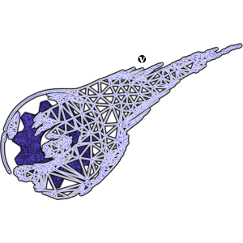

#  V-Gears Data Installation Guide

V-Gears doesn't include any of the data of Final Fantasy VII. `v-gears-installer` reads it from your own copy of the game and converts it to the formats V-Gears uses. It can be used with a window or from the command line, and both install in the same way.

## TL;DR

You need the ISO image of the PC install disk, and FFmpeg and TiMidity for the audio (for example `sudo apt install ffmpeg timidity`).

**With the window:** run `v-gears-installer`, select the ISO in **Final Fantasy VII ISO file**, and click **Install data**.

**From the command line:**

```Bash
v-gears-installer --iso ff7install.iso
```

Either way, everything is installed to the directory the game reads (`~/.v-gears/`, or `%USERPROFILE%\v-gears\` on Windows), and you can [run V-Gears](RUN.md "Run V-Gears") when it finishes. For the videos, run it again with each of the game disks 1, 2 and 3 (see [Extract the videos](#extract-the-videos)).

## Contents

- [What you need](#what-you-need)
- [The installation directory](#the-installation-directory)
- [Install with the window](#install-with-the-window)
- [Install from the command line](#install-from-the-command-line)
- [What can be installed](#what-can-be-installed)
- [Options](#options)
- [Extract the videos](#extract-the-videos)
- [Verify an installation](#verify-an-installation)
- [Troubleshooting](#troubleshooting)

## What you need

- **The ISO image of the install disk** of the PC version of the game. The installer reads the image directly: there is nothing to extract by hand. The disks of the PlayStation versions are not supported.
- **The ISO images of the PC game disks 1, 2 and 3**, only if you want the videos (see [Extract the videos](#extract-the-videos)).
- **FFmpeg and TiMidity**, for the sound effects, the music and the videos (see [FFmpeg and TiMidity](#ffmpeg-and-timidity)).
- **Free disk space:** a full installation uses about 1 GB. While installing, the installer needs about 3 GB plus the size of the ISO, and it checks that the space is there before it starts.

### FFmpeg and TiMidity

The installer converts the audio and the videos with two external programs:

- [FFmpeg](https://ffmpeg.org/download.html "FFmpeg") converts the sound effects, encodes the music and converts the videos. It must be able to write Ogg files (it needs the Vorbis encoder).
- [TiMidity](https://timidity.sourceforge.net/#download "TiMidity") plays the original MIDI music so FFmpeg can encode it. Only the music needs it.

In most GNU/Linux distributions both are available as packages:

| Distribution | Command |
|---|---|
| Debian, Ubuntu | `sudo apt install ffmpeg timidity` |
| Fedora | `sudo dnf install ffmpeg timidity++` |
| Arch | `sudo pacman -S ffmpeg timidity++` |
| macOS (Homebrew) | `brew install ffmpeg timidity` |

On Windows, download a build of FFmpeg and copy `ffmpeg.exe` to a `tools` folder next to the installer, or in the installation directory. TiMidity++ also needs its `timidity.cfg` and the instrument files next to `timidity.exe`.

The installer looks for each program in this order:

1. The program you chose: with **Locate…** in the window (the choice is remembered), or with `--ffmpeg` and `--timidity` in the command line.
2. A `tools` folder in the installation directory, then one next to the installer, then the folder of the installer itself.
3. The system `PATH`.

Every program is run once to check that it works. If one that the installation needs is missing, the installer says so before it starts, and what you would lose without it. The rest can be installed without the audio. To add it later, install the programs and run the installer again with only the sound effects and the music selected.

The silence at the end of each music track (the reverberation that TiMidity renders after the last note) is removed when the music is encoded. Otherwise, the scripts that wait for a track to end, such as the jingle of the inns, would wait for the silence too.

## The installation directory

The installation directory holds the configuration, the converted game data and the saves, and it is where the game runs. By default it is the one the game reads its data from:

| System | Default directory |
|---|---|
| GNU/Linux, macOS | `~/.v-gears/` |
| Windows | `%USERPROFILE%\v-gears\` |

It is created if it doesn't exist. After an installation it has:

| Path | What it is |
|---|---|
| `plugins.cfg`, `resources.cfg` | The configuration of V-Gears and Ogre. |
| `data/` | The game data: the V-Gears files (scripts, screens, fonts...) and the converted game data. |
| `data/config/config.cfg` | The configuration of the game (controls, options). An installation never replaces it if it exists. |
| `data/video/` | The videos, if you extracted them. |
| `save/` | The saved games, written by the game. |
| `temp/world_models/` | World map data that the game reads. |
| `install.info` | The record of the installations: the parts installed, with which version of the installer, and whether the last installation finished. See [Verify an installation](#verify-an-installation). |
| `installer.log` | The log of the last installation. |
| `install.log` | The log of Ogre during the last installation. |

During the installation the installer also extracts the install disk to `original_data/`, and writes temporary files to `temp/`. They are deleted at the end, unless you keep them with [Preserve original data](#preserve-original-data).

## Install with the window

Start the installer without arguments:

```Bash
~/V-Gears/build/bin/v-gears-installer
```

It can be started from any directory.

1. In **Final Fantasy VII ISO file**, select the ISO image of the install disk. The installer tells you if the image is valid and supported.
2. In **VGears installation directory**, select where to install (see [The installation directory](#the-installation-directory)). The installer remembers it.
3. Optionally, select **Show advanced options** to choose what to install and how (see [What can be installed](#what-can-be-installed) and [Options](#options)). The defaults install everything, and the estimate under the options shows about how much disk space it will use.
4. Click **Install data**.

The **Audio tools** line shows whether FFmpeg and TiMidity were found, with a **Locate…** link for each.

Before extracting anything, the installer checks that everything is in place: that the ISO is valid, that the directory is writable and has enough free space, that the V-Gears data files and the Ogre plugins can be found, and that the audio tools work. If something is wrong, it tells you what and doesn't start.

The progress bar and the log show how the installation goes. Problems are shown in color: red for errors, orange for warnings. Some warnings about skipped fields or models are expected: they are known limitations of the converter. The installation is finished when the bar reaches 100%.

When it finishes:

- **Verify install** checks that the directory has everything the game needs (see [Verify an installation](#verify-an-installation)).
- **Launch game** starts V-Gears from the installation directory.

You can install again, or extract the videos of another disk, without closing the window.

## Install from the command line

Any installation option makes the installer work from the command line, without its window. The simplest installation installs everything to the default directory:

```Bash
v-gears-installer --iso ff7install.iso
```

The command line installer doesn't need a display, so it can be used over SSH, in a container or in a script. In a terminal it shows a progress bar with what it is doing, and writes the warnings (in orange) and the errors (in red) above it. When the output goes to a file or a pipe, it writes a line for each percent and every message, without colors. Set `NO_COLOR` to turn the colors off in a terminal too.

When it finishes, it writes the number of errors and warnings, the first errors, and where the full log is.

### Examples

```Bash
# Everything, to another directory.
v-gears-installer --iso ff7install.iso --output ~/games/v-gears

# Only the field maps and their models (and the kernel data they need).
v-gears-installer --iso ff7install.iso --preset fields

# The battle data, plus the music.
v-gears-installer --iso ff7install.iso --preset battle --with music

# Everything except the music.
v-gears-installer --iso ff7install.iso --without music

# Only some parts.
v-gears-installer --iso ff7install.iso --preset custom --with kernel,fields,field-models

# Start again from nothing, and don't stop on warnings (for scripts).
v-gears-installer --iso ff7install.iso --clean --yes

# Add the videos of a game disk to an installation.
v-gears-installer --iso FF7DISC1.iso

# Check an installation.
v-gears-installer --verify --output ~/games/v-gears
```

### Arguments

| Argument | What it does |
|---|---|
| `-i`, `--iso <file>` | The disk image. The install disk installs the game; game disks 1, 2 and 3 only add their videos to an installation. |
| `-o`, `--output <dir>` | The installation directory. Default: the one the game reads (see [The installation directory](#the-installation-directory)). |
| `-p`, `--preset <name>` | What to install: `everything` (the default), `fields`, `world-map`, `battle`, `media` or `custom`. `custom` starts with nothing. See [Presets](#presets). |
| `--with <parts>` | Install these parts too, separated by commas. See [Parts](#parts). |
| `--without <parts>` | Don't install these parts, separated by commas. The parts that need them are left out too. |
| `--clean` | Delete the data of a previous installation first. See [Clean install](#clean-install). |
| `--keep-originals` | Keep the extracted disk, the temporary files and the original audio and images. See [Preserve original data](#preserve-original-data). |
| `--no-copy-data` | Don't copy the V-Gears data files. See [Copy V-Gears data files](#copy-v-gears-data-files). |
| `--data-dir <dir>` | The V-Gears `data` folder to copy. Default: looked for next to the installer and in the system. |
| `--ffmpeg <file>` | Path to FFmpeg. Default: looked for as explained in [FFmpeg and TiMidity](#ffmpeg-and-timidity). |
| `--timidity <file>` | Path to TiMidity. Looked for like FFmpeg. |
| `-y`, `--yes` | Continue when there are warnings or the audio tools are missing. Without it, the installer stops where the window would ask. |
| `--strict` | End with exit status 3 if the installation finished with errors in its log. Useful in scripts that must not accept a partial installation. |
| `--verify` | Check an installation instead of installing. See [Verify an installation](#verify-an-installation). |
| `--list-parts` | List the parts that can be installed. |
| `--cli` | Use the command line, not the window. Any of the options above already implies it. |
| `-h`, `--help` | Show the usage. |
| `-v`, `--version` | Show the version. |

`--option=value` works too, for example `--preset=fields`.

The window and the command line don't share settings: the command line doesn't use the FFmpeg and TiMidity programs you chose with **Locate…** in the window.

### Exit status

| Status | Meaning |
|---|---|
| `0` | The installation, the extraction or the verification went well. An installation that finished with some errors in its log still returns 0, unless `--strict` is given. |
| `1` | It failed, or it stopped because of a warning or a missing audio tool (use `--yes` to continue anyway), or the verification found something missing. |
| `2` | The command line is wrong. |
| `3` | With `--strict`: the installation finished, but there are errors in its log. |
| `130` | The installation was interrupted (Ctrl+C). The installation directory is incomplete until you install again. |

## What can be installed

### Parts

| Window option | Command line part | What it is | Needs |
|---|---|---|---|
| Extract game data | `kernel` | The kernel data: items, materia, characters, the initial savemap, the fonts. | |
| Extract field maps | `fields` | The field maps, their scripts, backgrounds and texts. | |
| Extract field 3D models | `field-models` | The models of the characters in the fields. | `fields` |
| Extract world map data | `world-map` | The world map. | the field maps, installed now or before |
| Extract world map 3D models | `world-map-models` | The models of the world map. | `world-map` |
| Extract battle data | `battle-data` | The battle scenes, enemies, formations, attacks and encounters. | |
| Extract battle models | `battle-models` | The battle models and animations, and the spell effects. | |
| Extract images | `images` | The images of the menus and the windows. | |
| Extract sound effects | `sounds` | The sound effects. | FFmpeg |
| Extract music tracks | `music` | The music. | FFmpeg and TiMidity |
| Extract videos | `videos` | The videos. They are not on the install disk: see [Extract the videos](#extract-the-videos). | FFmpeg |

A part can't be chosen without what it needs. In the window its option is disabled, and in the command line `--with field-models` alone is an error. When a part is removed, the parts that need it are removed too.

### Presets

| Window | Command line | Parts |
|---|---|---|
| Everything | `everything` | All of them. |
| Field maps and models | `fields` | `kernel`, `fields`, `field-models` |
| World map only | `world-map` | `world-map`, `world-map-models` |
| Battle data and models | `battle` | `kernel`, `battle-data`, `battle-models` |
| Media only (images, sounds, music, videos) | `media` | `images`, `sounds`, `music` |
| Custom | `custom` | None: choose them yourself. |

In the window the options can only be changed by hand with *Custom*. In the command line, `--with` and `--without` change any preset. For a later installation it's useful to install only what you need, for example only the fields, which is a few minutes faster.

The world map scripts need the field maps. To install only the world map, install the fields first, or together with it.

## Options

### Copy V-Gears data files

Window: **Copy V-Gears data files** (on by default). Command line: on unless `--no-copy-data`.

Copies the files that come with V-Gears (configuration, scripts, screens, fonts...) to the installation directory. They are taken from the `data/` folder of the repository, or `share/v-gears/` in an installed package. In the command line, `--data-dir` chooses another folder.

The game configuration (`data/config/config.cfg`) is only copied if the installation doesn't have it yet, so your settings are kept. Without this option, the installation directory must already have the V-Gears files.

### Clean install

Window: **Clean install** (off by default). Command line: `--clean`.

Before installing, deletes what a previous installation wrote: the converted game data in `data/`, the temporary files in `temp/` and the extracted disk in `original_data/`. A new installation then starts from nothing, without old files of parts you don't install this time.

It keeps:

- The saved games (`save/`).
- The controls (`controls.cfg`), the configuration of the game (`data/config/`) and the rest of the files in the root of the installation directory, such as `plugins.cfg` and the logs.
- The videos (`data/video/`), because they come from the game disks and the install disk can't put them back.

It needs **Copy V-Gears data files**, because the V-Gears files in `data/` are deleted too. It only deletes in a directory that is a V-Gears installation (it has `plugins.cfg` and `resources.cfg`). The window asks before deleting anything.

### Preserve original data

Window: **Preserve original data** (off by default). Command line: `--keep-originals`.

To convert the game, the installer extracts the install disk and some original files: the WAV sound effects, the MIDI music, the TEX images and the temporary files of the models. V-Gears doesn't use them, so they are deleted when the installation is complete. This option keeps them, for example to study the original files. It uses about 1 GB more.

The temporary files of the world map (`temp/world_models/`) are always kept, because the game reads them.

## Extract the videos

The videos are not on the install disk, but on the PC game disks 1, 2 and 3. To get them, run the installer once for each disk, with the same installation directory:

- In the window, select the disk's ISO and click **Install data**.
- In the command line, run `v-gears-installer --iso FF7DISC1.iso` (and the same for the other two disks).

The installer detects a game disk, extracts only its videos to `data/video/` and doesn't touch anything else. Several disks have the same videos, so those already installed are skipped. The options don't apply to a game disk, and `--clean` can't be used with one.

The engine can't decode the original AVI files (Duck TrueMotion 2 codec), so the installer uses FFmpeg to convert each video to a folder of JPEG frames, an `.ogg` sound track (if the video has sound) and a `movie.xml` with the frame count and the frame rate. The videos that carry camera data for the field background also get a `camera.cam` file. The engine's movie player draws the frames and plays the sound. FFmpeg is therefore needed to install the videos.

<!-- TODO(review): confirm the exact output layout under data/video/ (folder per movie, file names) after a fresh install, and which movies play in game. -->

## Battle data

The battle installation extracts the battle scenes, the enemy and formation data, the attacks, the field and world map encounter tables, and the battle models and animations. It also extracts the visual assets of the spell effects (`magic.lgp`): the meshes and textures of the effects and the sprite lists, which the battle scripts use to recreate the original spell effects. If you installed before these were added, run the installer again with the battle parts selected (the *Battle data and models* preset, or `--preset battle`) to get them.

<!-- TODO(review): list of spells with effects (currently the Fire, Ice, Bolt and Cure families) and the reinstall requirement should be re-checked against the current state of battle_fx.lua. -->

## Verify an installation

**Verify install** in the window, or `v-gears-installer --verify` in the command line (with `--output` for a directory other than the default), checks that the installation directory has everything the game needs. It lists what is missing, grouped by part.

It only checks that the files exist, it doesn't open them. If you skipped a part on purpose (for example the music), its files are expected to be missing. The Ogre plugins listed in `plugins.cfg` are looked for where the game looks for them: the installation directory, the directory of the game, and the Ogre directories of the system.

It also reads `install.info`, the record that the installer keeps of the installations, and reports:

- An installation that didn't finish, because it was interrupted (Ctrl+C, closing the window) or it failed.
- The parts that were converted by an older installer: when a new version of the installer converts something differently, the parts installed before have to be installed again. Installing only those parts is enough.
- An installation without a record, made before the installer kept one. Its data may be outdated.

The game checks the same record when it starts, and writes a warning if the data has to be installed again.

## Troubleshooting

- **The installation can't start.** The installer lists what is wrong. The most common problems are an ISO that isn't the PC install disk, a directory without enough free space, and missing Ogre plugins.
- **The sounds or the music are missing.** FFmpeg or TiMidity were not found or didn't work. Install them and run the installer again with only the sound effects and the music.
- **Warnings and errors in the log.** Some fields and models are skipped by known limitations of the converter, and some original files are dummies. A few dozen warnings and errors are normal. The full log is in `installer.log`, and the log of Ogre in `install.log`.
- **Old or wrong files after reinstalling.** Install again with **Clean install** (`--clean`).
- **The game says the data must be installed again.** The last installation didn't finish, or some parts were installed by an older installer. Run `v-gears-installer --verify` to see which, and install them again.

## Next steps

- [Run V-Gears](RUN.md "Run V-Gears")
