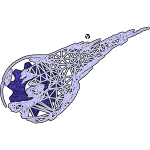

#  V-Gears Data Run Guide

## Run the engine

If you have followed the [build](BUILD.md "Building guide") and [installaton](INSTALL.md "Installation guide") guides, you'll have the game data installed to `~/.v-gears/`, and the binaries compilled somewhere (we'll assum they are in `~/V-Gears/build/bin`, change the directories according to your system).

Run the engine from any directory:

```Bash
~/V-Gears/build/bin/v-gears
```

The engine looks for its data directory in this order, and changes into it:

1. The directory given with `--data-dir`, for example `v-gears --data-dir ~/games/v-gears`.
2. The directory in the `VGEARS_DATA_DIR` environment variable.
3. The current directory, if it has the V-Gears files (`plugins.cfg` and a `data` folder).
4. `~/.v-gears/` (`%USERPROFILE%\v-gears\` in Windows), the same default as the data installer.

If the chosen directory doesn't have the V-Gears files yet, the engine copies them there from the `data/` folder of the repository (or from `share/v-gears` in an installed package; `VGEARS_TEMPLATE_DIR` overrides it). Files that are already there are never overwritten. The data of the original game still has to be added with the data installer.

The data installer also has a **Launch game** button, which starts the engine with the installation directory.

## Key Mappings

Here is a list of key mappings, adapted from the PSX version of the game:

- &#129033;: Up
- &#129034;: Right
- &#129035;: Down
- &#129032;: Left
- &#10799;: ?
- &#9633;: ?
- &#9675;: Space bar
- &#9651;: Esc
- &#11207;: Enter
- &#9644;: ?
- **R1**: ?
- **L1**: ?
- **R2**: ?
- **L2**: ?
