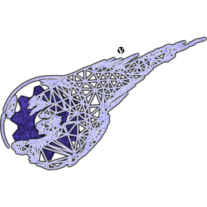

#  V-Gears Run Guide

## Run the engine

If you have followed the [build](BUILD.md "Building guide") and [installaton](INSTALL.md "Installation guide") guides, you'll have the game data installed to `~/.v-gears/`, and the binaries compilled somewhere (we'll assum they are in `~/V-Gears/build/bin`, change the directories according to your system).

On a terminal, go into the game data folder, and from there, run the engine

```Bash
cd ~/.v-gears/;
~/V-Gears/build/bin/v-gears;

```

The data installer also has a **Launch game** button, which starts the engine from the installation directory.

## Controls

The default bindings are in `config/config.cfg` of the installation directory, in the `bind_game_event` lines. The game reads them as events, so the menus, the field and the battles share them. They can be changed there.

|Key|Event|Action|
|--|--|--|
|Arrow keys|Up, Down, Left, Right|Move, move through menus|
|Enter, Space|CONFIRM|Confirm, talk, interact|
|Esc|CANCEL|Cancel, go back|
|M|MENU|Open the main menu|
|Backspace|EXTRA|Extra action in some menus|
|P|START|Start|
|V|SELECT|Select|
|Page Up / Page Down|L1 / R1|Switch tab or character in menus|
|Left Ctrl|run|Run in the field|

The settings made in the in-game config menu (controls, sound, etc.) are saved with the game settings and loaded on start.

<!-- TODO(review): verify the table against the in-game config menu (control remapping), and check the gamepad status. -->

## Debug keys

These are also defined in `config.cfg`:

- **F11**: pause / resume the game timer. **Num +** / **Num -**: change the game speed.
- **F12**: take a screenshot.
- **Left Ctrl + Left Alt** plus **S, F, E, T, W, G, A, B, U, M**: toggle the debug displays (script, FPS, entities, triggers, walkmesh, grid, axis, background, UI, messages).
- **F8** / **F9**: show / hide the begin menu.
- **Alt + F4**: quit.
